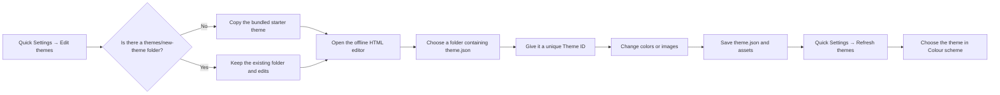

# Make and edit DEAS themes

[Documentation index](README.md) · [Studio and Quick Settings](STUDIO.md#layout-last-used-state-and-quick-settings) · [Credits](CREDITS.md)

A theme pack is a small local data folder: one validated `theme.json` manifest plus optional PNG or static WebP images. It cannot contain or execute JavaScript, HTML, CSS or programs. It may change the existing UI's colour tokens and background/cursor/scrollbar images; it does not change models, recipes, navigation, downloads or job execution.

The nine built-in schemes remain compiled into DEAS and are always available. External packs are only changes layered over a built-in `base`. The nine built-ins are therefore **not duplicated** as supplied external packs.

## Quick Settings flow

Open **Quick Settings → Edit themes**.



The editor is opened by DEAS but runs in the browser. DEAS never loads or executes the HTML as application code.

## Create your first theme

1. Select your DEAS environment in **Backend**.
2. Click **Quick Settings → Edit themes**.
3. DEAS creates `themes/new-theme` in the selected environment only when absent and opens the editor.
4. Click **Choose theme folder** and select that `new-theme` folder. The browser asks permission for the chosen folder; nothing is uploaded.
5. Replace its Theme ID with a unique lowercase value, for example `my-space-blue`. `new-theme` is only the initial template.
6. Pick a built-in `base` and change only the colours you want. Omitted colours inherit the base palette.
7. Optionally replace images through the image rows, or drag a PNG/WebP onto a row.
8. Click **Save changes**.
9. Return to DEAS and click **Quick Settings → Refresh themes**, then select it under **Colour scheme**.

Deleting a custom theme folder and refreshing removes only its entry. A saved theme that cannot be loaded falls back to Default without erasing the saved selection.

## Make another theme or a shareable pack

Duplicate an existing folder inside `<environment>/themes/`, then give the duplicate a unique Theme ID. Sharing means sending the complete theme folder. Keep any third-party artwork's attribution/license files beside it.

A minimal manual theme is valid without images:

```json
{
  "schemaVersion": 1,
  "id": "my-space-blue",
  "name": "My Space Blue",
  "author": "Your name",
  "base": "sage",
  "colors": {
    "deep": "#070b18",
    "panel": "#141b2c",
    "chalk": "#f0f5ff",
    "blue": "#91b8ff",
    "ok": "#8fd7a3",
    "on-ok": "#102018",
    "line": "#39445c"
  }
}
```

Folder layout:

```text
my-space-blue/
├── theme.json
└── assets/
    ├── background.webp
    └── cursor.png
```

`theme.json` references them as `assets/background.webp` and `assets/cursor.png`. The older layout may place the PNG/WebP directly in the theme folder instead.

## Data format (schema version 1)

```json
{
  "schemaVersion": 1,
  "id": "my-theme",
  "name": "My theme",
  "author": "Your name",
  "base": "default",
  "colors": {"panel": "#1c241e", "ok": "#c7e9a7"},
  "assets": {"background": "assets/background.webp", "cursor": "assets/cursor.png"}
}
```

- `id`: unique lowercase letters, digits and hyphens, at most 64 characters.
- `name` and `author`: printable text, at most 120 characters.
- `base`: one built-in scheme ID—`default`, `sage`, `liiti-pink`, `voud`, `alluring-abyss`, `slimy-teal`, `clawy-grey`, `android-white` or `dragons-hoard`.
- `colors`: supported colour tokens, using `#RGB`, `#RRGGBB` or `#RRGGBBAA`.
- `assets`: optional `background`, `cursor` and `scrollbar` roles.
- Asset filenames are lowercase letters, digits and hyphens with `.png` or `.webp`, either in the theme folder or one level under `assets/`.
- Cursors use a 3×4 hotspot; 32×32 transparent PNG is recommended.
- A pack may contain at most 16 assets. Each image may be at most 2 MiB, 4096 pixels per side and 16 MiB decoded. The whole scan has a 16 MiB compressed-image budget.
- `theme.json` is at most 64 KiB and unknown fields are rejected.

The authoritative limits live in `src-tauri/src/themes.rs`.

## Offline editor details

The canonical editor is:

```text
theme-packs/EDIT-THEMES.html
```

It is bundled with the application. Quick Settings opens it; users do not need to copy a separate per-theme editor.

What the editor does:

- Opens a folder containing `theme.json` through the browser's directory permission.
- Edits identity, colours and images in memory.
- Writes new selected images under `assets/` with fresh filenames.
- Backs up the previous manifest and replaced images in `backups/`.
- Refuses external edits made to `theme.json` after the folder was opened.
- Offers JSON download when the browser lacks directory access; image replacement then remains disabled.

Chrome and Edge are the supported browsers for direct folder access. Firefox does not provide the required directory-editing API. The editor is English-only and has no network code.

## Recovery and safety

Before saving:

- The editor creates `backups/theme-<timestamp>.json`.
- A replaced image is copied into `backups/` under its recorded name.

If DEAS shows a bad result, choose **Default**, restore the backup files into the theme folder, and refresh. An external pack that reuses a built-in ID overrides only that entry in that environment; deleting it restores the built-in behavior.

DEAS rejects parent traversal, absolute paths, URLs, drive syntax, backslashes, symlinked or reparse-point theme paths, malformed JSON and oversize images/manifests. Invalid packs are skipped independently. Duplicate IDs are rejected together instead of choosing one by directory order.

Native commands are `native_theme_packs(root)` and `native_theme_editor(app, root)`, behind `allow-native-theme-packs`. The selected root must be an existing absolute environment. Edit themes creates the environment's `themes/` directory and copies the bundled `new-theme` starter only if that starter folder is absent. It never overwrites an existing `new-theme` folder and never copies the nine built-in schemes.

## Verification boundaries

Rust filesystem tests, React component tests and the Chromium offline-editor tools verify catalog parsing, no-clobber starter copying, traversal/link rejection, caps and editor save races. They do not prove every OS's browser directory permission dialog or default-browser behavior. Windows WebView2 and Linux WebKitGTK/external browser acceptance remain open in [PLAN.md](PLAN.md).

Pack integrity is recorded in [`theme-packs/FILES.json`](../theme-packs/FILES.json).
